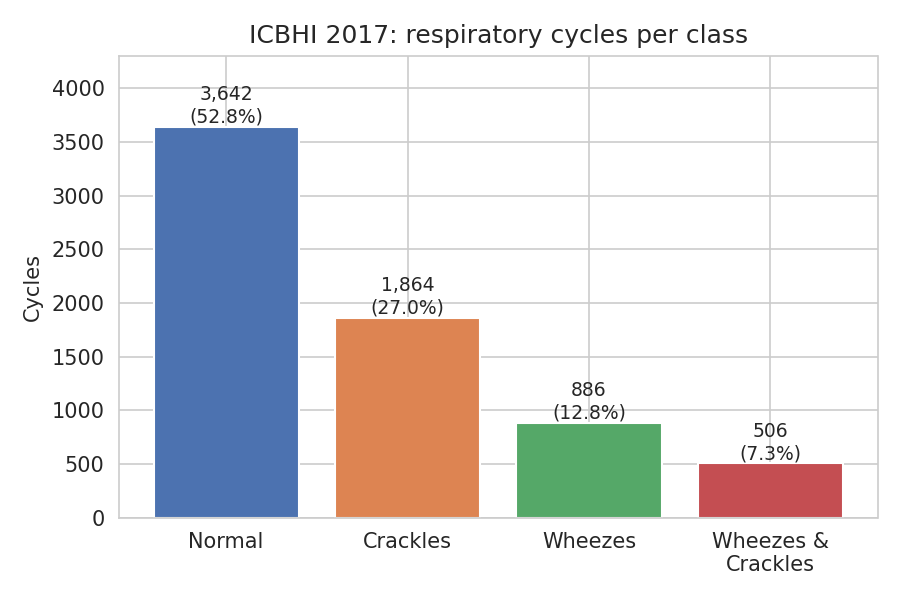
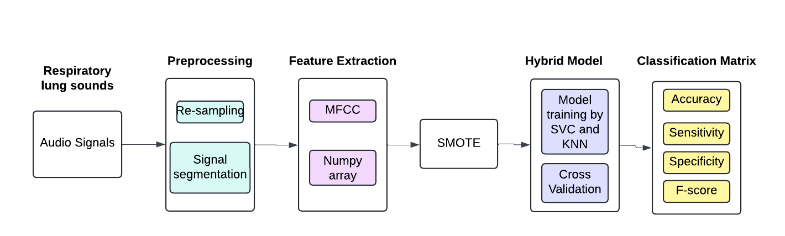
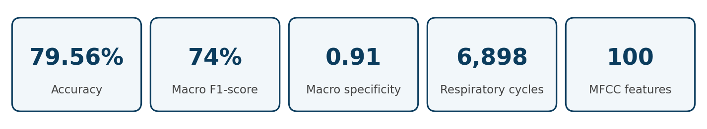
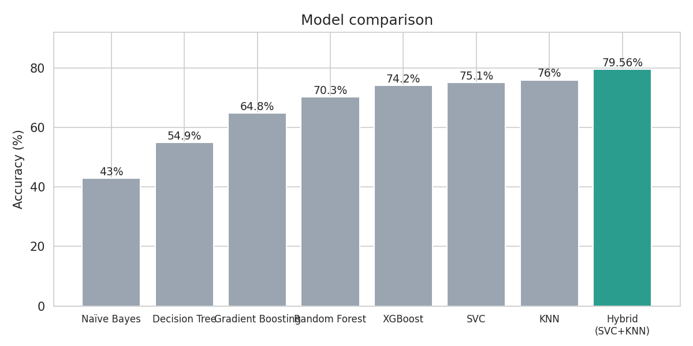
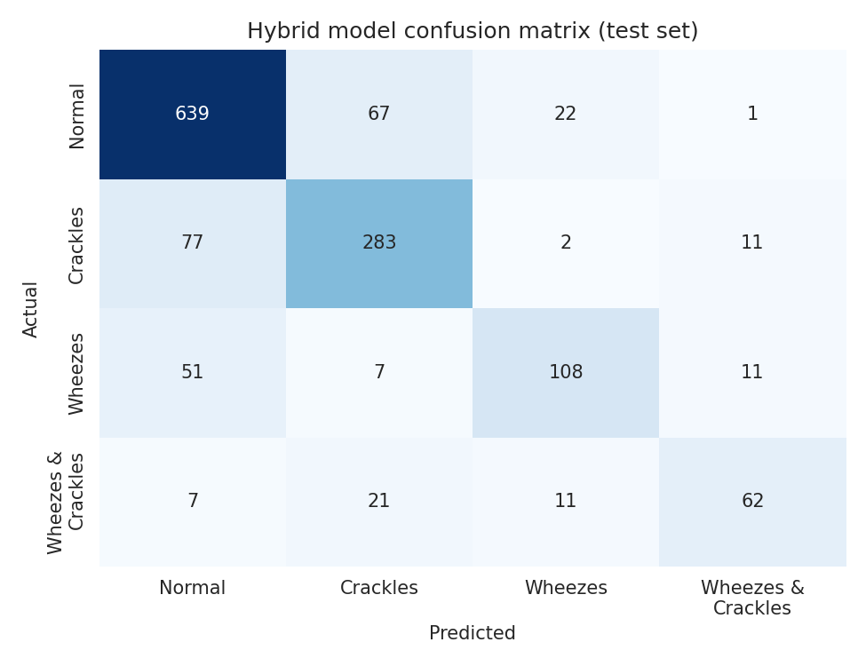
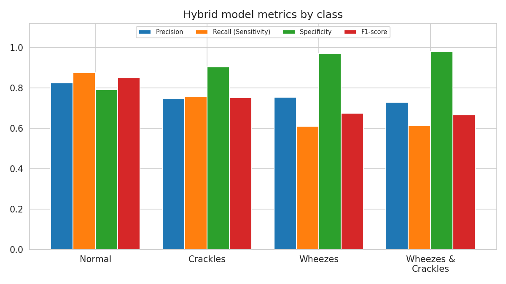

<p align="center">
  
</p>

# Lung Sound Classification for Chronic Respiratory Disease

**End-to-end machine learning project using Python and scikit-learn on 6,898 annotated respiratory cycles from the ICBHI 2017 lung sound database.**


---

## Table of Contents
1. [About the Project](#about-the-project)
2. [Problem Statement](#problem-statement)
3. [Objectives](#objectives)
4. [Tools and Technologies](#tools-and-technologies)
5. [Dataset](#dataset)
6. [Methodology](#methodology)
7. [Key Findings](#key-findings)
8. [Model Performance](#model-performance)
9. [Practical Implications](#practical-implications)
10. [Project Structure](#project-structure)
11. [Conclusion and Future Scope](#conclusion-and-future-scope)

---

## About the Project

Chronic respiratory diseases such as COPD and bronchitis are among the world's major chronic conditions. Doctors often screen for them by listening to the lungs with a stethoscope, but this depends on the listener's experience, and recordings are often mixed with background noise. Standard tests such as chest X-rays and CT scans add radiation exposure and cost.

This project builds a lightweight, non-invasive classifier that listens to a single breathing cycle and decides whether it is **normal** or contains **crackles**, **wheezes**, or **both**. Audio is cleaned and segmented, converted to MFCC features, balanced with SMOTE, and classified by a **hybrid model** that stacks an SVC and a KNN under a Logistic Regression meta-learner.

The project accompanies the research paper *"Designing a Hybrid Model for Chronic Respiratory Disease using Lung Sound Classification"*.

| | |
|---|---|
| **Respiratory cycles analysed** | 6,898 |
| **Recordings** | 920 (10 to 90 seconds each) |
| **Participants** | 126 |
| **Total audio** | About 5.5 hours |
| **Classes** | 4 (Normal, Crackles, Wheezes, Wheezes + Crackles) |
| **Features per cycle** | 100 (50 MFCCs, mean and standard deviation) |

## Problem Statement

> *Can a simple, interpretable machine learning pipeline detect abnormal lung sounds accurately enough to support clinicians, even when the data is noisy and heavily imbalanced?*

This is a research and learning project. The results come from a public dataset and the model is not a medical device.

## Objectives

1. Prepare raw lung-sound recordings into clean, labelled respiratory-cycle segments.
2. Extract compact and informative audio features using MFCC.
3. Handle the strong class imbalance in the data.
4. Compare several classical machine learning models on the same split.
5. Build a hybrid SVC + KNN model that outperforms the individual models.
6. Evaluate with accuracy, sensitivity, specificity, precision and F1-score.

## Tools and Technologies

| Area | Tools |
|---|---|
| Language and environment | Python, Jupyter Notebook / Google Colab |
| Audio processing | librosa, SciPy, `wave` |
| Machine learning | scikit-learn (SVC, KNN, Random Forest, Gradient Boosting, Decision Tree, Naive Bayes, Logistic Regression), XGBoost |
| Imbalance handling | imbalanced-learn (SMOTE) |
| Techniques | MFCC, StandardScaler, GridSearchCV, stratified split, stacking, cross-validation |
| Visualisation | matplotlib, seaborn |
| Documentation | Research paper (PDF), Git and GitHub |

## Dataset

| Item | Detail |
|---|---|
| **Source** | [ICBHI 2017 Respiratory Sound Database](https://bhichallenge.med.auth.gr/ICBHI_2017_Challenge) (also on Kaggle) |
| **Files used** | `.wav` recordings and matching `.txt` annotation files (cycle start, end, crackle flag, wheeze flag) |
| **Conditions** | Includes both clean recordings and recordings with real background noise |
| **Target variable** | Respiratory sound class (4 classes) |
| **Not included** | The dataset is not stored in this repository. Download it separately |
| **Licence** | Check the ICBHI challenge page for terms of use and credit the dataset authors |

**Class distribution**

| Class | Label | Cycles | Share |
|---|:---:|---:|---:|
| Normal | 0 | 3,642 | 52.8% |
| Crackles | 1 | 1,864 | 27.0% |
| Wheezes | 2 | 886 | 12.8% |
| Wheezes + Crackles | 3 | 506 | 7.3% |
| **Total** | | **6,898** | 100% |



## Methodology



```
Audio (.wav + .txt) -> Resample -> Segment into cycles -> MFCC features -> Split + scale -> SMOTE -> SVC + KNN -> Logistic Regression meta-model -> Evaluation
```

1. **Load.** Recordings are grouped by patient ID (first three characters of each filename).
2. **Resample.** All audio is resampled to one common rate using linear interpolation so features are comparable across devices.
3. **Segment and label.** Each recording is cut into respiratory cycles using the annotation times. Labels: 0 Normal, 1 Crackles, 2 Wheezes, 3 Both.
4. **Extract features.** 50 MFCCs per cycle (25 ms window, 10 ms hop), summarised by the mean and standard deviation of each coefficient. The result is a 2D NumPy array with one row per cycle.
5. **Split and scale.** 80/20 stratified train-test split (`random_state=42`). `StandardScaler` is fitted on the training data only.
6. **Balance.** SMOTE generates synthetic samples for minority classes, applied to the training set only so the test set stays untouched.
7. **Train and tune.** Seven classical models are trained. SVC and KNN are tuned with grid search.
8. **Build the hybrid.** SVC and KNN predicted probabilities are concatenated and used as input to a Logistic Regression meta-model.
9. **Evaluate.** Accuracy, precision, sensitivity, specificity, F1-score, confusion matrix and cross-validation.

**Tuned hyperparameters**

| Model | Settings |
|---|---|
| SVC | RBF kernel, `C=4`, `gamma=0.03125`, `class_weight='balanced'` |
| KNN | `n_neighbors=3`, `metric='manhattan'`, `weights='distance'` |

## Key Findings

| # | Finding |
|---|---|
| 1 | **The hybrid model is the best performer.** 79.56% accuracy and 74% F1-score, ahead of the best single model (KNN, 76%) and SVC (75.1%) |
| 2 | **Model choice matters a lot.** Accuracy ranges from 43% (Naive Bayes) to 79.56% (hybrid). Distance and margin-based models (KNN, SVC) suit MFCC features better than tree-based models |
| 3 | **Class imbalance is the core challenge.** Normal cycles are 52.8% of the data and Wheezes + Crackles only 7.3%. SMOTE and the hybrid approach were the main factors in the improvement |
| 4 | **Normal and Crackles are detected well.** Normal has 0.83 precision and 0.88 recall. Crackles reach about 0.76 precision and recall |
| 5 | **Wheezes are the hardest class to catch.** Recall is about 0.61 for both Wheezes and Wheezes + Crackles. For example, 51 of 177 wheeze cycles (29%) were predicted as Normal |
| 6 | **Few false alarms on rare classes.** Specificity is 0.97 for Wheezes and 0.98 for Wheezes + Crackles, and the macro-average specificity is 0.91 |
| 7 | **Comparable or better than published work on the same dataset.** 79.56% against 77.81% for a Bi-ResNet model (2024) and 71.15% for a CNN with parallel pooling (2020), using a much lighter model |

### Headline Metrics



## Model Performance



| Model | Accuracy |
|---|---:|
| Naive Bayes | 43.0% |
| Decision Tree | 54.9% |
| Gradient Boosting | 64.8% |
| Random Forest | 70.3% |
| XGBoost | 74.2% |
| SVC | 75.1% |
| KNN | 76.0% |
| **Hybrid (SVC + KNN)** | **79.56%** |

<p align="center">
  
  
</p>

### Deeper Look at the Hybrid Model

<p align="center">
  
  
</p>
<p align="center">
  
</p>

The normalised matrix shows what fraction of each real class the model gets right. Recall drops as classes get rarer, and most errors for Wheezes and Wheezes + Crackles are confusions with Normal and Crackles.

### Comparison with Previous Work (ICBHI 2017)


| Study | Method | Accuracy |
|---|---|---:|
| Wu et al., 2024 | Bi-ResNet, STFT, wavelet | 77.81% |
| Demir et al., 2020 | CNN with parallel pooling, LDA with RSE | 71.15% |
| Nguyen and Pernkopf, 2022 | ResNet with co-tuning (4-class) | 58.29% |
| **This work** | **SVC + KNN hybrid with SMOTE** | **79.56%** |

> Previous studies use different splits and evaluation protocols (for example patient-level versus cycle-level), so the comparison is indicative, not strict.

## Practical Implications

| Priority | Recommendation | Evidence |
|---|---|---|
| 1 | Use MFCC with SVC and KNN as a lightweight screening aid where deep learning is too heavy to deploy | Hybrid reaches 79.56% without a neural network |
| 2 | Always handle imbalance explicitly (SMOTE, class weights) when training on clinical sound data | Rare classes make up only 7% to 13% of cycles |
| 3 | Collect more wheeze recordings and report per-class recall, not only overall accuracy | Wheeze recall is about 0.61 while overall accuracy looks high |
| 4 | Validate at the patient level before any real-world use | Cycle-level splits can overestimate generalisation |
| 5 | Treat the system as decision support for clinicians, not as a diagnosis | Roughly 1 in 5 cycles is still misclassified |

## Project Structure

```
lung-sound-classification/
├── README.md
├── requirements.txt
├── .gitignore
│
├── lung_sounds.ipynb                    # full pipeline: preprocessing, features, models, evaluation
│
├── documents/
    └── Research_Paper.pdf               # full research paper
└──images/                          # charts used in this README
        ├── banner.png, kpi_cards.png
        └── fig01 ... fig08 (.png)
```

## Conclusion and Future Scope

A simple MFCC-based pipeline, combined with SMOTE and a hybrid SVC + KNN model, classifies four types of lung sound with 79.56% accuracy and performs competitively with heavier deep learning approaches on the same dataset. The model handles Normal and Crackles well, but rare and subtle classes (Wheezes, Wheezes + Crackles) remain the main weakness.

**Limitations:** the split is random at the cycle level (not patient-level), the dataset is a single public collection, and results are observational and not clinically validated.

**Next steps:** patient-level cross-validation, richer features (mel-spectrograms, delta-MFCCs, wavelets), noise reduction, CNN or CNN-LSTM comparison, probability calibration, and testing on additional respiratory sound datasets.


## Acknowledgements

Dataset by the ICBHI 2017 Challenge organisers. Built with librosa, scikit-learn, imbalanced-learn and XGBoost.

> **Disclaimer:** This project is for research and educational purposes only. It is not a medical device and must not be used for clinical diagnosis.
